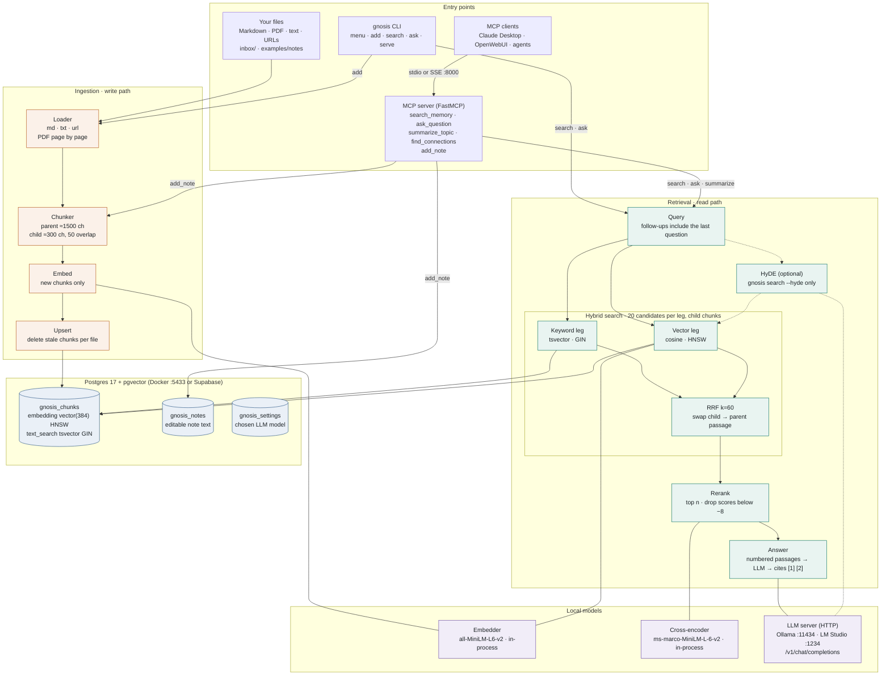

# Architecture

Everything runs locally: two small models in-process, an LLM over HTTP, and one Postgres database that holds both the vector index and the full-text index.

## Asking a question

1. The question (plus the previous one, for follow-ups) is embedded with MiniLM.
2. Postgres runs a cosine search and a full-text search over child chunks, 20 hits each.
3. Reciprocal Rank Fusion merges the two lists, and each child is replaced by its parent passage.
4. The cross-encoder rescores the passages, keeps the top 5 and drops anything below −8.
5. The LLM answers only from the numbered passages and cites them inline.

HyDE is used by `gnosis search --hyde` only. `find_connections` uses the vector search alone, with no keyword search or reranking.

## Adding notes

1. A loader turns a file or URL into documents; PDFs become one document per page.
2. Each document splits into ~1500-character parents and ~300-character children.
3. IDs already in `gnosis_chunks` are skipped; only new chunks get embedded.
4. New chunks are upserted, and chunks from an older version of the same file are deleted.

Notes written in the menu or via `add_note` also keep their full text in `gnosis_notes` so they can be edited later.

## Docker stack

| Service       | Role                                                        |
| ------------- | ----------------------------------------------------------- |
| `db`          | `pgvector/pgvector:pg17`, host port `127.0.0.1:5433`        |
| `ollama`      | LLM server on the internal network                          |
| `ollama-pull` | One-shot download of `qwen2.5:1.5b`                         |
| `gnosis`      | Seeds `examples/notes`, then serves MCP over SSE on `:8000` |

Outside Docker, set `DATABASE_URL` and `LLM_BASE_URL` in `.env`.
